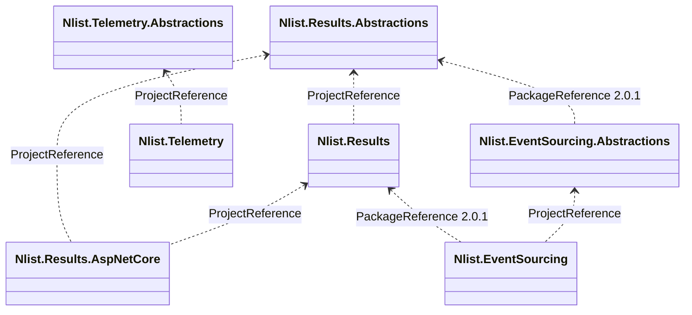

# nlist-packages

A monorepo (one repo, many projects) of small .NET libraries published to GitHub Packages.

## Monorepo

Each top-level folder is a package family that lives here but builds, versions and publishes on
its own.

```
nlist-packages/
├── .github/workflows/           one workflow per family
├── nlistid-results/src/         Nlist.Results.*
├── nlistid-telemetry/src/       Nlist.Telemetry.*
└── nlistid-event-sourcing/src/  Nlist.EventSourcing.*
```

- **No root solution.** Run `dotnet` from a project's own folder.
- **One version per family.** Each workflow sets `VERSION`; every package in that family ships at it.
- **Path-filtered publishing.** A workflow runs only when its family's library folders or the workflow file change.
- **Within a family**, projects use `ProjectReference`.
- **Across families**, projects use `PackageReference` to a published version, e.g. `nlistid-event-sourcing` uses `Nlist.Results` 2.0.1.
- **Shared** across all projects: the root `.editorconfig` and `.gitignore`.

## Packages

| Folder | Packages | Published by |
|---|---|---|
| `nlistid-results/` | `Nlist.Results.Abstractions`, `Nlist.Results`, `Nlist.Results.AspNetCore` | `nlistid-results.yml` |
| `nlistid-telemetry/` | `Nlist.Telemetry.Abstractions`, `Nlist.Telemetry` | `nlistid-telemetry.yml` |
| `nlistid-event-sourcing/` | `Nlist.EventSourcing.Abstractions`, `Nlist.EventSourcing` | `nlistid-event-sourcing.yml` |



Package docs:

- [Nlist.Results](nlistid-results/src/Nlist.Results/README.md) and [SPEC.md](nlistid-results/SPEC.md)
- [Nlist.Results.AspNetCore](nlistid-results/src/Nlist.Results.AspNetCore/README.md)
- [Nlist.Telemetry](nlistid-telemetry/src/Nlist.Telemetry/README.md)
- [Nlist.EventSourcing](nlistid-event-sourcing/README.md)

## Build

Requires the .NET 10 SDK. There is no root `.sln`; build each project from its own folder.

```bash
cd nlistid-results/src/Nlist.Results.AspNetCore   # also builds Nlist.Results + Abstractions
dotnet build
dotnet format --verify-no-changes

cd nlistid-telemetry/src/Nlist.Telemetry          # also builds Nlist.Telemetry.Abstractions
dotnet build

cd nlistid-event-sourcing/src/Nlist.EventSourcing # also builds Nlist.EventSourcing.Abstractions
dotnet build
```

`nlistid-event-sourcing` restores `Nlist.Results` packages from GitHub Packages, so it needs the source below.

## Consume the packages

```bash
dotnet nuget add source https://nuget.pkg.github.com/nlistid/index.json \
  --name github-nlist \
  --username <your-github-username> \
  --password $(gh auth token) \
  --store-password-in-clear-text
```

## Publish

Each workflow has a hardcoded version at the top:

```yaml
env:
  VERSION: 2.0.1
```

1. Bump `VERSION` in the workflow file.
2. Push to `main`.

Every package in the family is packed and pushed at that version. A run without a bump fails,
because GitHub Packages rejects an existing version.

Keep `PackageId` in the `.csproj`. Passing `/p:PackageId=...` to `dotnet pack` breaks
`ProjectReference` restore with `Ambiguous project name`.

## Contributing

1. Branch, edit, run `dotnet build` and `dotnet format --verify-no-changes`.
2. Open a pull request.
3. After merge, bump `VERSION` to publish.
