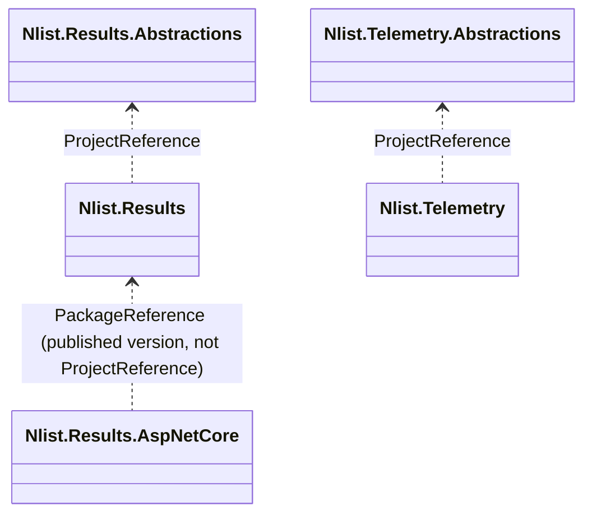

# nlist-packages

A monorepo of small, independent .NET libraries published to GitHub Packages.

## Project Structure

- **`nlistid-results/`** — `Nlist.Results.Abstractions` holds a single interface, `IResult<T>`
  (`IsSuccess`, `Value`, `Detail`), with no dependencies of its own. `Nlist.Results` holds every
  concrete type (`Result<T>` — which implements `IResult<T>` — plus `SuccessResult<T>`,
  `FailureResult<T>`, `NotFoundResult<T>`, `ValidationResult<T>`, `ConflictResult<T>`,
  `UnexpectedResult<T>`), the `Bind`/`Map` composition behavior, and `ResultFactory`, via a
  `ProjectReference` to `Nlist.Results.Abstractions`. `Nlist.Results.AspNetCore` maps results onto
  ASP.NET Core HTTP/problem-details responses. `Nlist.Results.Test` exists as a placeholder
  directory — no test project has been created yet.

- **`nlistid-telemetry/`** — `Nlist.Telemetry.Abstractions` holds just the interfaces
  (`ITelemetry<T>` and friends) with no package dependencies. `Nlist.Telemetry` implements them
  as an OpenTelemetry-shaped facade (tracing, logging, metrics, baggage, correlation) via a
  `ProjectReference`.

Each package family is independent — there is no solution (`.sln`) file tying them together, and
no shared versioning between `nlistid-results` and `nlistid-telemetry`.

### Relationships



Both `*.Abstractions` projects hold interfaces only and take no `PackageReference` of their own, so
a consumer can depend on the shape (`IResult<T>`, `ITelemetry<T>`) without pulling in the concrete
package's implementation or dependencies.

Each `*.Abstractions` package is packed and published **alongside** its main package, pinned to
the same version, by the same workflow — see [Publishing](#publishing). It is not published
independently or versioned on its own schedule.

## Getting Started

### Prerequisites

- [.NET 10 SDK](https://dotnet.microsoft.com/) (targets mix net8.0 and net10.0 — see each `.csproj`)
- Git
- GitHub CLI (`gh`), or a Personal Access Token with the `read:packages` scope

### GitHub Packages Authentication

`Nlist.Results.AspNetCore` references `Nlist.Results` as a published NuGet package (not a project
reference), so restoring it needs an authenticated NuGet source. This repo has no checked-in
`NuGet.Config` — add the source to your user-level config instead:

```bash
dotnet nuget add source https://nuget.pkg.github.com/nlistid/index.json \
  --name github-nlist \
  --username <your-github-username> \
  --password $(gh auth token) \
  --store-password-in-clear-text
```

Prefer an environment-variable-backed credential over a token pasted into
`~/.nuget/NuGet/NuGet.Config` in clear text — rotate immediately if you ever find one there.

## Building

Each project builds independently; there is no root solution file.

```bash
# Nlist.Results (pulls in Nlist.Results.Abstractions via ProjectReference)
cd nlistid-results/src/Nlist.Results
dotnet build

# Nlist.Results.AspNetCore
cd nlistid-results/src/Nlist.Results.AspNetCore
dotnet build

# Nlist.Telemetry (pulls in Nlist.Telemetry.Abstractions via ProjectReference)
cd nlistid-telemetry/src/Nlist.Telemetry
dotnet build
```

### Formatting

Both `nlistid-results` projects enforce code style at build time
(`EnforceCodeStyleInBuild=true`) via StyleCop and a strict `.editorconfig`. Verify formatting
before committing:

```bash
dotnet format --verify-no-changes
```

## Publishing

Each package *family* publishes via its own GitHub Actions workflow in `.github/workflows/`,
triggered by a push to `main` that touches either project's `src/**` (or the workflow file
itself). Each workflow packs and pushes **both** its main package and its `*.Abstractions`
companion, pinned to the same `env.VERSION`:

| Workflow | Publishes | Version pin |
| --- | --- | --- |
| `nlistid-results.yml` | `Nlist.Results.Abstractions`, `Nlist.Results` | `env.VERSION` in the workflow file |
| `nlistid-telemetry.yml` | `Nlist.Telemetry.Abstractions`, `Nlist.Telemetry` | `env.VERSION` in the workflow file |

To cut a release:

1. Bump `env.VERSION` in the relevant workflow file.
2. Commit and push to `main` (editing the workflow file is itself a trigger, so the version bump
   and the release push are the same commit).
3. The workflow packs each project, then pushes both `.nupkg` files to
   `https://nuget.pkg.github.com/nlistid/index.json` using the built-in `GITHUB_TOKEN` — no extra
   secret setup needed in CI. The push step passes `--skip-duplicate` so re-running the workflow
   (e.g. via `workflow_dispatch`) doesn't fail just because one of the two packages already exists.

There is no "already published" guard beyond that — if `VERSION` isn't bumped at all, the push
still fails because GitHub Packages rejects re-publishing an existing version.

**`PackageId` is set inside each `.csproj`, not passed as `/p:PackageId=...` on the `dotnet pack`
command line.** That command-line form is a global MSBuild property that cascades into the
`ProjectReference` restore graph and makes NuGet throw `Ambiguous project name` — it will break
the pack step entirely for any project with a `ProjectReference`, which is both main packages
here. Keep new packages following this pattern (`PackageId` in the csproj; `Version`/`Authors`/
`Description`/`RepositoryUrl` are fine as command-line overrides).

If you bump `Nlist.Results`'s version, remember `Nlist.Results.AspNetCore`'s `PackageReference` to
it is pinned by hand in `Nlist.Results.AspNetCore.csproj` and needs updating separately — the
`AspNetCore` package is not published by `nlistid-results.yml` and does not move with it.

## Contributing

1. Create a branch for your changes.
2. Make edits to the relevant package.
3. Run `dotnet format --verify-no-changes` and `dotnet build`.
4. Commit and create a pull request.
5. After merge, bump `env.VERSION` in the relevant workflow file to publish (see
   [Publishing](#publishing)).
