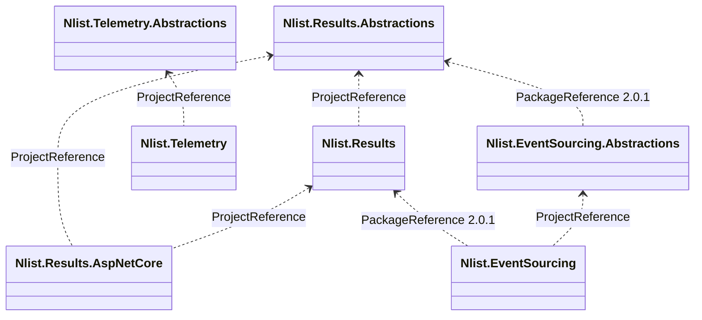

# nlist-packages

Small, focused .NET 10 libraries for building services: typed results instead of exceptions,
an OpenTelemetry-shaped telemetry facade, and event-sourced aggregates and projections.
Published to GitHub Packages.

## Projects

### Nlist.Results — [`nlistid-results/`](nlistid-results/)

Return a `Result<T>` instead of throwing for expected failures. Each failure type carries its HTTP
status (`NotFoundFailureResult<T>` is 404, `ValidationFailureResult<T>` is 422, and so on), and
`Bind`/`Map` chain operations that skip ahead on the first failure. The ASP.NET Core package turns
any result into a JSON response or an [RFC 9457](https://www.rfc-editor.org/info/rfc9457/) problem details response.

```csharp
app.MapGet("/users/{id}", (int id) => factory.ToHttpResult(
    GetUser(id)
        .Bind(user => ValidateUser(user))
        .Map(user => new UserDto(user.Id, user.Name))));
```

| Package | Holds |
|---|---|
| `Nlist.Results.Abstractions` | `IResult<T>`. No dependencies. |
| `Nlist.Results` | `Result<T>`, the failure types, `ResultFactory`, `Bind`/`Map` extensions on `IResult<T>` |
| `Nlist.Results.AspNetCore` | `HttpResultFactory`: results to HTTP responses |

Docs: [Nlist.Results](nlistid-results/README.md)

### Nlist.Telemetry — [`nlistid-telemetry/`](nlistid-telemetry/)

One injectable `ITelemetry<T>`, used in place of `ILogger<T>`, that covers tracing, logging,
metrics, baggage and a correlation ID that ties together work that doesn't share a trace
(an HTTP trigger and the queue trigger it starts). Built on OpenTelemetry; export is configured as usual.

```csharp
using var span = telemetry.Tracing.StartActiveSpan("Send enquiry emails");
telemetry.Logging.LogInformation("Sending emails.");
telemetry.Metrics.IncrementCounter("EnquiryEmailsSent");
```

| Package | Holds |
|---|---|
| `Nlist.Telemetry.Abstractions` | The interfaces. No dependencies. |
| `Nlist.Telemetry` | The implementation and `services.AddTelemetry()` |

Docs: [Nlist.Telemetry](nlistid-telemetry/README.md)

### Nlist.EventSourcing — [`nlistid-event-sourcing/`](nlistid-event-sourcing/)

Event-sourced aggregates in two styles: a mutable `BaseAggregate<T>` that raises and applies events,
or a pure `IDecider<TCommand, TEvent, TState>` (decide, evolve, fold). Adds snapshots, projectors
for read models, and storage-agnostic repository interfaces with optimistic concurrency.
Failures are returned as `Nlist.Results`.

```csharp
var history = await events.ReadStreamAsync(id, 0, ct);
var state = decider.Fold(history.Value!.Cast<AccountEvent>());

var decision = decider.Decide(command, state);
await events.AppendAsync(id, state.Version, decision.Value!, ct);
```

| Package | Holds |
|---|---|
| `Nlist.EventSourcing.Abstractions` | Events, snapshots, entities, repositories, `IAggregate<T>`, `IDecider<…>`, `IProjector<T>` |
| `Nlist.EventSourcing` | `BaseAggregate<T>`, `BaseProjector<T>` |

Docs: [Nlist.EventSourcing](nlistid-event-sourcing/README.md)

## Monorepo

Each top-level folder is a package family that lives here but builds, versions and publishes on
its own.

```
nlist-packages/
├── .github/workflows/           one workflow per family
├── nlistid-results/src/         Nlist.Results.*
├── nlistid-telemetry/src/       Nlist.Telemetry.*
└── nlistid-event-sourcing/src/  Nlist.EventSourcing.*
```

- **No root solution.** Run `dotnet` from a project's own folder.
- **One version per family.** Each workflow sets `VERSION`; every package in that family ships at it.
- **Path-filtered publishing.** A workflow runs only when its family's library folders or the workflow file change.
- **Within a family**, projects use `ProjectReference`.
- **Across families**, projects use `PackageReference` to a published version, e.g. `nlistid-event-sourcing` uses `Nlist.Results` 2.0.1.
- **Shared** across all projects: the root `.editorconfig` and `.gitignore`.

| Folder | Published by |
|---|---|
| `nlistid-results/` | `nlistid-results.yml` |
| `nlistid-telemetry/` | `nlistid-telemetry.yml` |
| `nlistid-event-sourcing/` | `nlistid-event-sourcing.yml` |



## Build

Requires the .NET 10 SDK. There is no root `.sln`; build each project from its own folder.

```bash
cd nlistid-results/src/Nlist.Results.AspNetCore   # also builds Nlist.Results + Abstractions
dotnet build
dotnet format --verify-no-changes

cd nlistid-telemetry/src/Nlist.Telemetry          # also builds Nlist.Telemetry.Abstractions
dotnet build

cd nlistid-event-sourcing/src/Nlist.EventSourcing # also builds Nlist.EventSourcing.Abstractions
dotnet build
```

`nlistid-event-sourcing` restores `Nlist.Results` packages from GitHub Packages, so it needs the source from [Install](#install).

## Publish

Each workflow has a hardcoded version at the top:

```yaml
env:
  VERSION: 2.0.1
```

1. Bump `VERSION` in the workflow file.
2. Push to `main`.

Every package in the family is packed and pushed at that version. A run without a bump fails,
because GitHub Packages rejects an existing version.

Keep `PackageId` in the `.csproj`. Passing `/p:PackageId=...` to `dotnet pack` breaks
`ProjectReference` restore with `Ambiguous project name`.

## Contributing

1. Branch, edit, run `dotnet build` and `dotnet format --verify-no-changes`.
2. Open a pull request.
3. After merge, bump `VERSION` to publish.
